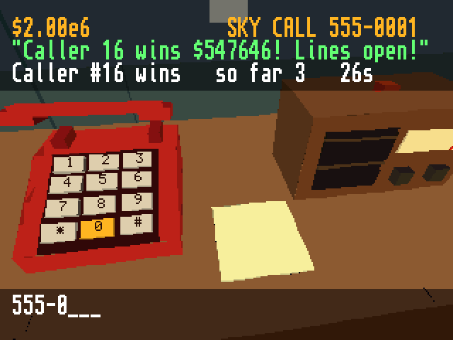

# dialtone



Two incremental PS1 games on one disc, picked on the boot screen, sharing the desk, the phone and
its keypad, each with its own save file.

**Radio contests**, the first game, is about phoning in to radio contests. The DJ says "caller 5 wins $20", you
dial the station, and if you get through as the fifth caller the money is yours. Buy a redial
button, a second line and an autodialer that starts out dumb and learns to time its calls, climb
from a local station to a satellite one where prizes run to the millions, then move to a new area
code for Reputation and perks that make the next run faster. Numbers go past a billion and keep
going; progress saves to the memory card.

**Phone books** is the second: you are stuck making cold calls for a corporation that never says
what it sells. It pays a little per call and more for a sale. Buy phone books and work through
them number by number, buy lines and an autodialer that runs several calls at once, answer the
corp when it rings about your quota, and when the residential books are done a note turns up from
somebody higher up who wants out too. Then take the promotion: it pays standing for permanent
perks and starts you again in small business. Residential and the first small business book are
in; the categories above are later.

How to play, every upgrade and every number: [radio contests](docs/manual.md),
[phone books](docs/phonebooks.md).

Built on [psyqo-madnight-engine](https://github.com/Forceh91/psyqo-madnight-engine), pulled in
as a submodule and not modified.

## Building

```
git clone --recursive https://github.com/rixnobis/dialtone
cd dialtone
make BUILD=ReleaseFast DEFINES=PCDRV
./tools/make_assets.sh
```

That gives `dialtone.ps-exe` plus `build/dialtone.bin`, the asset archive a PCDRV build reads off
the host. Run it with pcsx-redux:

```
cp dialtone.ps-exe build/
pcsx-redux -run -pcdrv -pcdrvbase build -loadexe build/dialtone.ps-exe
```

`tools/autoplay.lua` and `tools/run.sh` pick the game on the boot screen with `MODE=radio` (the
default) or `MODE=books`. For a disc image instead, build without `DEFINES=PCDRV` (run `make clean` first, the engine is
built with the same defines) and run pcsx-redux's `authoring` tool on `toc.json`.

Phone books can also have callers who talk. The recorded lines live in a separate repository,
[dialtone-assets](https://github.com/rixnobis/dialtone-assets); the build takes them only when you
pack them in:

```
git clone https://github.com/rixnobis/dialtone-assets ../dialtone-assets
python3 -I tools/pack_voices.py ../dialtone-assets     # writes assets/VOICE/
./tools/make_assets.sh                                 # or just the make_image.py line in it
```

For a disc, `python3 -I tools/make_toc.py > toc-full.json` and give `authoring` that file instead
of `toc.json`. Without `assets/VOICE` everything builds and plays as before, callers silent. All
the lines sit in sound RAM from boot (about 0x7c000 bytes are set aside for them, at 8000 Hz).
The office musak needs nothing extra: `tools/make_musak.py` writes `src/musak_data.inc`.

`make_assets.sh` needs Blender (headless is fine) and Python with numpy. The desk lives in
`tools/build_desk.py`, which also saves `blender/desk.blend` to look at and writes
`src/desk_layout.hh` with where the keys, handset and lamps go. The meshbins it produces are
committed, so you only need Blender to change the desk.

`make DEFINES="PCDRV DIALTONE_START_CASH=300"` starts you with money, for trying the upgrades; it
counts as earned, so 2000000 opens every station and the first new area code. In phone books it
is plain cash; `DIALTONE_SEED=N` fixes the books (and prints every number, for scripted runs, which
dial with `DIAL="vsync:digits,..."`), and `DIALTONE_PREDIAL=N` starts with every number called but
the last N of the last book, to reach the note quickly. `tools/run.sh`
runs a headless session with `tools/autoplay.lua` driving the pad (`CARD=` keeps the memory card
between runs, `SEQ=` presses buttons at given frames). `tools/test_bignum.sh` checks the number
type on the host.

## Where things are

- `src/mode_scene.cpp`: the boot screen that picks the game.
- `src/sim.cpp`: the radio game. Stations, contest rounds, busy/ringing odds, lines, upgrades, price
  curves, Reputation and perks. No rendering in here, so it is the file to change for balance.
- `src/bignum.cpp`: the number type, a 9-digit mantissa and a power of ten, integer only.
- `src/book_sim.cpp`: the phone books game: the books, call outcomes, lines, the autodialer, the
  corp, the note. No rendering either.
- `src/save.cpp`: the memory card saves, one file per game, loaded when the game is picked and
  written in the background.
- `src/phone_scene.cpp`: the radio desk scene, input, the text overlay and the Reputation screen.
- `src/book_scene.cpp`: the phone books desk, the book panel, supplies, the office and the note.
- `src/musak.cpp`: the office musak in phone books, a 16-bar bossa loop on SPU voices 8-15 from
  five tiny synthesised instruments (`tools/make_musak.py`), ducked under voices, Triangle in the
  office turns it off.
- `src/voice_lines.cpp`: the optional caller and supervisor lines: one in two pick-ups speaks,
  never two at once, never the same line twice running.
- `src/tones.cpp`: DTMF, ringback, busy and the win jingle, generated on the SPU from a
  two-block looping sine (loop start on the first block, end + repeat on the second), no sample
  files.
