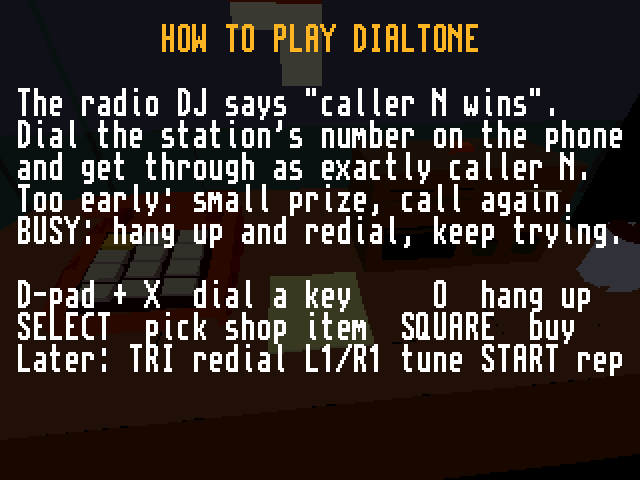
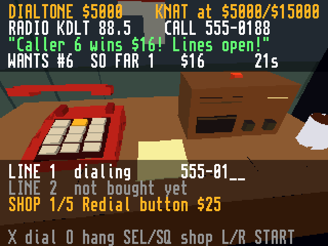
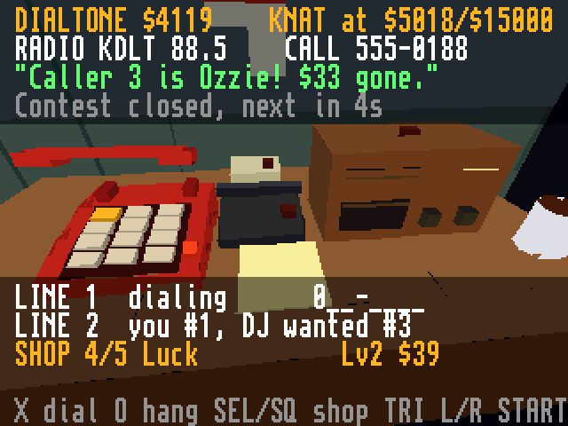
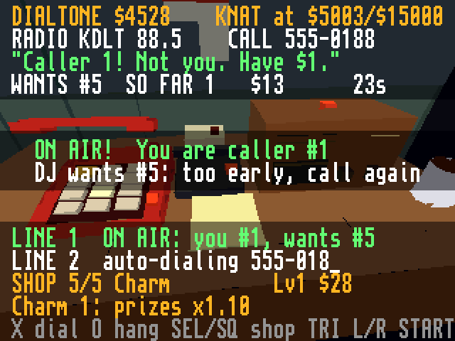
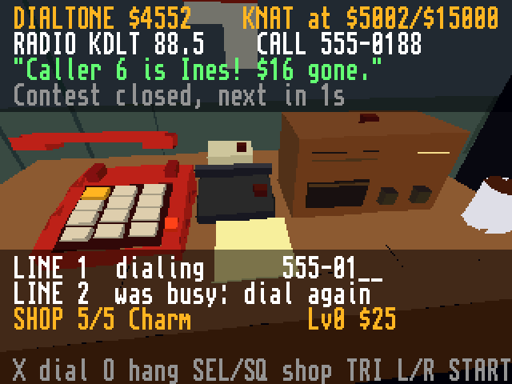
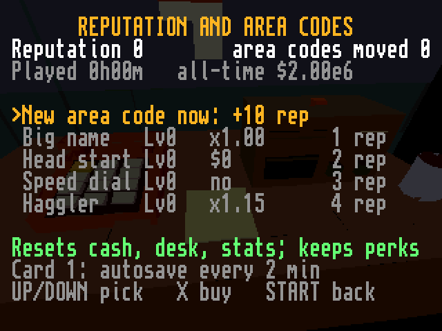

# How to play dialtone

You sit at a desk with a phone and a radio. The DJ keeps running the same contest: "caller N wins".
Dial the station and get through as exactly the Nth caller to win the prize. Win, buy things
that make you better at winning, move up to bigger stations, and when the numbers stop being fun,
move to a new area code and start over with a reputation.

## Controls

| Button | Does |
| --- | --- |
| D-pad | move over the keypad |
| X | dial the key under the cursor |
| O | hang up every line that is dialing, ringing or busy |
| Triangle | redial the station (once you own the redial button) |
| Select | step through the shop |
| Square | buy what the shop row shows |
| L1 / R1 | tune the radio down / up (stations you have opened) |
| START | the Reputation screen; it also closes the how-to-play card |

## A contest

The top of the screen is the radio. `WANTS #6  SO FAR 2  $16  19s` means the DJ wants caller
6, two people have got through, the prize is $16 and the contest closes in 19 seconds. Other
listeners call in too, and every one of them who gets through moves the count on. If one of them
reaches the number, they win and the contest closes. If nobody does before the clock runs out,
the prize rolls over into the next contest. After a few seconds' break a new contest opens with a
new number.

Dial the station's number (it is on the second row) on the keypad. After the seventh digit the
call connects, then it either rings or comes back busy. A ringing call reaches the DJ after a
second or two and you go on air as the next caller:

- the right caller: you win the prize, and the banner says so;
- too early: you get a small consolation prize (5% of the contest prize, at least $1) and the
  count moves on, so call again;
- no contest running: nothing, wait for the next one.

Timing is the whole game. Watch the count, and dial so that you get through just as it reaches
the number. When the count is two short of it, everybody piles on and the lines get busier.

## Your lines

The two rows at the bottom say what each line is doing:

| Row says | Means |
| --- | --- |
| not bought yet | line 2 before you buy the second line |
| free: dial the station now | idle, and a contest is open |
| dialing / auto-dialing | digits going in, by you or by redial and the autodialer |
| connecting | all seven digits in, the exchange is putting you through |
| ringing the DJ... | you got a line, you will be on air in a moment |
| BUSY | the station is engaged; hang up or wait and dial again |
| WRONG NUMBER | a digit was wrong; the row after it shows the right number |
| ON AIR: you #3, wants #6 | you are on air as caller 3, too early |
| WINNER! | you were the one |
| was busy: dial again | the last try was busy |
| you #5, DJ wanted #6 | how close the last try came |
| too late, contest over | you got through after the contest closed |

## The shop

The shop row shows one thing at a time; Select steps to the next and Square buys it. The row is
amber when you can afford it and grey when you cannot.

First come two desk items, each bought once, and each shows up on the desk:

- **Redial button**, $25: Triangle dials the station for you on a free line.
- **Second line**, $60: a second phone and a second line to call on.

Then the levelled upgrades. Each level costs more than the last: the price of the next level is
its base price times 1.15 to the power of the levels you already have (Haggler, below, brings the
1.15 down).

| Upgrade | Base | Levels | Each level |
| --- | --- | --- | --- |
| Autodialer | $120 | 10 | see below |
| Quick fingers | $20 | 5 | redial dials faster (6 frames a digit down to 1), and every call connects sooner after the last digit (30 frames down to 5) |
| Luck | $30 | 12 | the station is busy 6 points less often, never below 10% |
| Charm | $25 | no cap | every prize, and so every consolation, x1.1 (compounding) |

### The autodialer starts out bad, on purpose

A machine that dialed perfectly from the moment you bought it would play the game for you. So the
first autodialer is a cheap box that does not listen to the radio: it waits ten seconds on a free
line before grabbing it, dials slowly, works only one line (the last one you own), and calls
whether or not a contest is on. It earns a little while you are away from the pad, but it wins
less than you do. Each level makes it better:

| Level | Lines | Waits on a free line | Frames a digit |
| --- | --- | --- | --- |
| 1 | 1 | 10 s | 12 |
| 2 | 1 | 7 s | 11 |
| 3 | 2 | 5 s | 10 |
| 4 | 2 | 3.5 s | 9 |
| 5 | 2 | 2.5 s | 8 |
| 6 | 2 | 1.7 s | 7 |
| 7 | 2 | 1.2 s | 6 |
| 8 | 2 | 0.75 s | 5 |
| 9 | 2 | 0.5 s | 4 |
| 10 | 2 | 0.33 s | 3 |

It never dials faster than your redial does, so Quick fingers caps it.

From level 6 it learns what you know: it holds off until the DJ's count is two short of the
number, then redials free lines straight away. From level 8 it waits until the count is one short.
In a two-and-a-half-minute test with nobody touching the pad, a level 1 autodialer won once; a
level 7 one, with Quick fingers and Luck at 5, won seven times.

## Stations

The radio has four stations, each a wall: much bigger prizes, much bigger crowds. A station opens
once you have earned enough in the current area code; the top row shows the next one and how far
you are.

| Station | Reach | Number | Prize | Wants caller | Busy | Opens at |
| --- | --- | --- | --- | --- | --- | --- |
| KDLT 88.5 | local | 555-0188 | $12-30 | 3-6 | 35% | start |
| WHOT 104.7 | regional | 555-1047 | $150-400 | 6-11 | 50% | $300 |
| KNAT 96.1 | national | 555-0961 | $5,000-12,000 | 9-16 | 62% | $15,000 |
| SKY 1 | satellite | 555-0001 | $300,000-750,000 | 14-24 | 72% | $1,000,000 |

Rival callers get through faster on bigger stations. Prizes are multiplied by Charm and by the Big
name perk. Changing station hangs up your lines and drops any rollover.

Numbers up to 999,999 are shown in full; after that they are written like `1.23e6` (1.23
million), `4.56e12`, and so on. There is no top.

## Reputation and new area codes

START opens the Reputation screen. Everything you have ever earned, in every area code, counts
towards Reputation: your total is the square root of all-time earnings divided by $20,000, rounded
down. That is 1 point at $20,000, 4 at $320,000, 10 at $2 million and 100 at $200 million.

**New area code** pays out the points you have earned since the last move and starts you over:
cash, desk items, upgrades and station go back to the beginning. Reputation, perks and all-time
earnings stay. It asks twice before it does it. The top row tells you when a move would pay
(`START: +10 rep`).

Reputation buys perks, and perks are kept forever:

| Perk | First level | Each level | Price of the next level |
| --- | --- | --- | --- |
| Big name | prizes x2 | doubles every prize again | 1 x 3^level |
| Head start | start an area code with $100 | ten times the start cash | 2 x 4^level |
| Speed dial | start an area code with the redial button | one level | 3 |
| Haggler | shop prices grow x1.14 a level | 0.01 less, down to x1.10 at 5 | 4 x 2^level |

Head start and Speed dial act from the next area code; the others act straight away.

## Saving

The game saves to the memory card in slot 1, as `DIALTONE` with a red phone icon. It loads at
boot and saves:

- every two minutes of play, at the next break between contests,
- right after a new area code,
- at the next break after you buy a perk.

The memory card has the controller to itself while it writes, about three seconds, which is why
saves wait for the break between contests; the round row says `SAVING` while it happens. The
Reputation screen says when the last save was.

With no card, an unformatted card or a damaged save, the game says so at boot and plays on without
saving. A card put in later is picked up at the next autosave. Play time on the Reputation screen
comes from the console's frame counter, so it keeps counting correctly however long you play.
