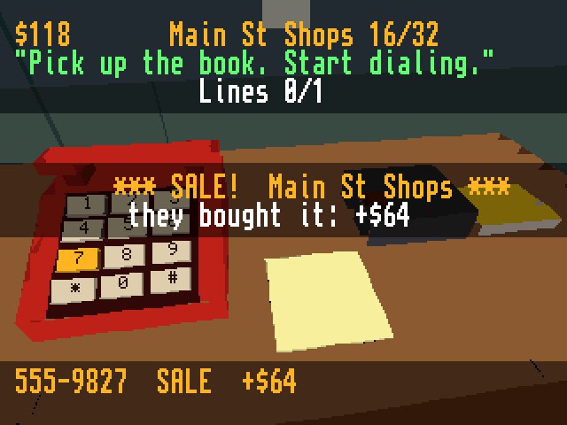
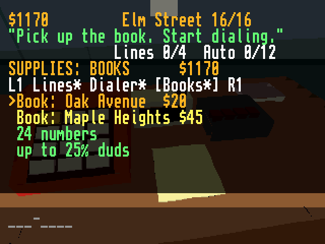
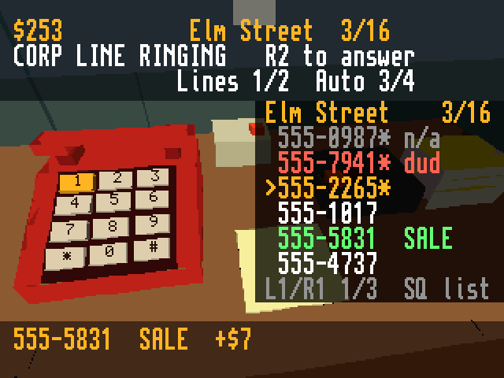
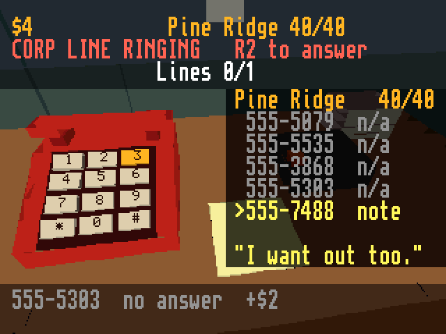
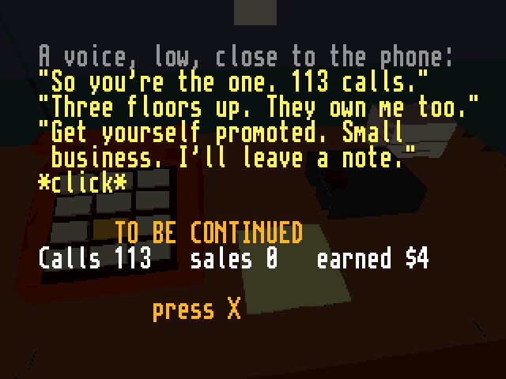
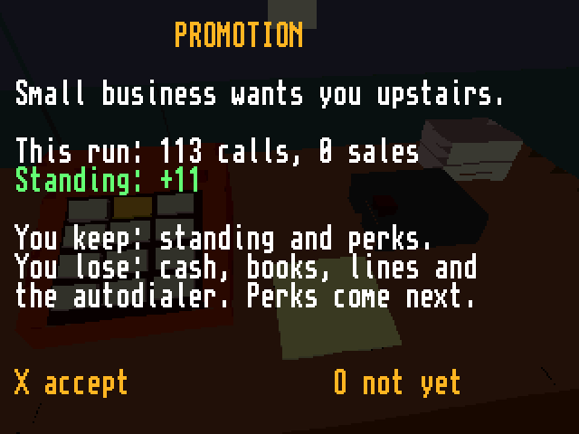
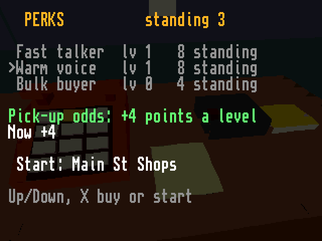

# Phone books

The second game on the disc, picked on the boot screen. You are stuck at a desk making cold calls
for a corporation that never says what it sells, and you do not remember applying. The corporation
pays a little for every call that rings and a bonus for a sale. Buy phone books and work through
them, number by number. Somebody higher up is watching your numbers.

What is in: the four residential books, lines, an autodialer that grows into a bank of calls, the
corp on the phone, the first note, and the promotion to small business, which has one book so far.
Large business and CEOs are later; the office shows them locked.

## Controls

| Button | Does |
| --- | --- |
| D-pad | move over the keypad |
| X | dial the key under the cursor |
| O | take back the last digit you dialed |
| L2 | hang up your call |
| R2 | answer the corp line when it rings; otherwise open the book at the next number nobody has called |
| Triangle | open and close the phone book |
| L1 / R1 | move up / down the book (book open); past either end, your next or previous book |
| Square | put the number under the cursor on the autodialer's list, or take it off |
| Square, held 1 s | empty the autodialer's list (book open) |
| Select | supplies, in three tabs: lines, the autodialer and its parts, phone books |
| L1 / R1 (supplies open) | switch tab |
| START | the office: your stats, the books, the categories, the promotion; X there shows the how-to-play card |

## The screen

Four rows, always: your cash with the book you are working and how many of its numbers you have
called, the corp line in quotes, your quota and how many of your lines are busy (plus the
autodialer's list once you own one), and at the bottom the number on your handset. The book, the
shop and the office are panels you open when you want them.

## Calling

Open the book (Triangle), read a number, close it or leave it open, and dial it on the keypad.
Every number is 555 and four digits. After the seventh digit the call connects and one of these
happens:

| Outcome | How often | Holds the line | Pays | The book marks it |
| --- | --- | --- | --- | --- |
| not in service | the book's dud chance, fixed per number | a moment | nothing | `dud` |
| they listen and buy | about a third of the pick-ups | the whole pitch, 4 s | fee + bonus | `SALE` |
| they listen, then "no thanks" | the other two thirds | 2.5 s | fee | `no sale` |
| no answer (two rings, 8 s) | half of the rest | 8 s | fee | `n/a` |
| hello, not interested, click | the other half | under a second | fee | `hung` |

A phone that picks up does so after the first ring (2.2 to 3.7 s), a little later if the caller's
voice is still loading off the CD. While somebody is listening you cannot tell a sale from a waste of time: the handset row says
"they're listening..." either way. A dud answers with the fast busy tone, which stops after a
second and a half or as soon as you dial the next digit. A dud stays a dud. Somebody who already
bought hangs up on you every time after, so a `SALE` number only pays the fee again; a `no sale`
number is worth calling again. A number that is in no book of yours is not in service. You can
hang up (L2) at any time, but a call you hang up on pays nothing.

R2 (when the corp is not ringing) opens the book at the next number nobody has called, from the
cursor on, then in your other books. It skips the numbers on the autodialer's list unless nothing
else is left. The book's bottom line takes turns between its keys.

## The books

Every number in a book has to be called once (any outcome) to finish it. Books are bought in
supplies (Select). Supplies has three tabs, switched with L1/R1: Lines, Autodialer (the dialer and
its parts) and Books. A tab with something you can afford right now carries an asterisk, so you can
see that books are for sale. The Books tab lists each book for sale on its own row; the one under
the cursor shows only how many numbers it has and "up to N% duds". Its pick-up chance and what a
call and a sale pay you find out by dialing. A category's first book is handed to you. Finishing books puts more
of them up for sale, so after Elm Street you choose between two. If every number in the books you own has been called and
you cannot afford the cheapest book for sale, nothing could ever pay for it, so the corp hands that book
over free with a line on its message row.

| Book | Numbers | Duds | Pick-up | Fee | Bonus | Price | For sale after |
| --- | --- | --- | --- | --- | --- | --- | --- |
| Elm Street | 16 | 30% | 60% | $1 | $12 | yours | |
| Oak Avenue | 24 | 25% | 54% | $1 | $18 | $20 | 1 book done |
| Maple Heights | 32 | 20% | 48% | $2 | $28 | $45 | 1 book done |
| Pine Ridge | 40 | 15% | 42% | $2 | $40 | $90 | 2 books done |
| Main St Shops (small business) | 32 | 20% | 50% | $4 | $60 | yours | |

About a third of the pick-ups buy (34% residential, 36% small business; the rest are `no sale`).
Your books stand on the desk, the finished ones on a grey pile behind. When the book you are
working is finished the panel turns to another of yours still to finish; when there is none, the
banner says to buy the next one. L1/R1 past the end of a book turns to your next book. The numbers
are generated from a seed picked on a new game and kept in the save.

## Lines

You start with one line. Supplies sells more, up to ten, at $30 for the second and twice the price
for each one after ($60, $120, $240, ... $7680 for the tenth). A line board on the desk has a lamp
per line you own, lit while it is on a call. Your handset takes the first free line; with every
line busy the keypad gets "every line is busy".

## The autodialer starts out bad, on purpose

$25 in supplies, once you own a second line (with one line it has nothing to dial on, and the Autodialer tab says `needs a 2nd line`). It sits on the desk in its own box with a red readout, like an alarm clock: the top
row is the number it is dialing, digit by digit (`READY` between calls, `NO LIST` with nothing to
dial), the bottom row is `L` calls going / calls it may run, and `Q` how many numbers are on its
list. Its lamp blinks while it has a call going. The phone's keypad lights only for your own
presses; you hear the tones of one of its calls, the one on the readout.

It knows nothing of the phone book: you give it a list. With the book open, Square puts the number
under the cursor on its list (a `*` beside it), or takes it off. It works down the list and starts
it again, forever, with no judgement at all: duds, numbers that already said no, numbers you already
sold to. It never takes the line your handset is on.

Each autodialer level runs one more call at the same time: level 1 one call, level 2 two, and so on,
but never on more than every line you own but one (one line stays yours). With a single line it
shares it with you, as it always did. The price doubles a level like a line does ($25, $50, $100,
$200); levels 5 and up need a promotion and cost three times as much again. After each call the line
it used rests before it dials on it again.

| | Starts at | Motor 1 ($60) | Motor 2 ($150) |
| --- | --- | --- | --- |
| time per digit | 40 frames | 22 | 10 |
| rest after a call | 3 s | 1.7 s | 0.8 s |

The list holds 4 numbers, 8 with the first bigger tray ($80), 12 with the second ($200). It takes
numbers from any book of yours, and a book's numbers leave the list when the book is finished.
Holding Square for a second with the book open empties the whole list. It pays the same fee and
bonus as a call you make yourself.

## The corp calls you

About a minute in, and then every 3 to 4 minutes, the corp line rings (the lamps flash, the
second row turns red). R2 answers it. Its clock stops while somebody is listening on your own line,
so it never cuts into a pitch. The first call sets a quota of 8 calls per line you own before the
next one. Each quota you meet raises it by 2 calls per line (up to 14 per line), each one you miss
lowers it by 2 again. When it calls again:

- quota met: you get half the quota in dollars;
- quota missed: you lose a dollar per missing call, never below zero;
- you do not answer within 8 seconds: you lose $3 and it calls back a minute later, the quota
  still standing.

Between calls the corp line says something motivational every 25 seconds or so.

## The office

START: calls made, sales, duds, money earned, play time, the books of your category (yours with
their progress, for sale with their price, or how many must be done first), the other categories,
your standing, and the memory card. X there shows the how-to-play card again, or, once a promotion
is on offer, takes you to it (Square then shows the card).

## The note

When every number in the four residential books has been called, a sticky note turns up in the
book. It reads like one more entry, in yellow at the end of Pine Ridge, and the banner says who left
it: somebody who saw your numbers and wants out too. Dial it by hand (the autodialer cannot read
handwriting). A short call, then "to be continued", then back to the desk, and the office offers a
promotion.

## Promotion

In the office, X on the promotion shows what it pays and what it takes: you get standing, a point
for every 10 calls and every 2 sales of this run, and you lose your cash, your books, your lines and
the autodialer; the screen itself only says `Standing: +N`. X accepts, O turns it down for now. Then the perks: standing buys them for good,
and unspent standing stays for the next time.

| Perk | A level does | Levels | Price |
| --- | --- | --- | --- |
| Fast talker | a sale's pitch 12% shorter (4 s at level 0, 1.6 s at 5) | 5 | 4, 8, 12, 16, 20 standing |
| Warm voice | pick-up chance +4 points in every book | 5 | the same |
| Bulk buyer | autodialer, motor and tray 10% cheaper | 5 | the same |

Start puts you in small business with Main St Shops and a new desk. For now its book is the only
one: once it is done, the office offers a promotion again (small business again, a fresh book and a
fresh desk, more standing). Large business and CEOs are later.

## Saving

Phone books has its own save file on the memory card in slot 1 (DIALBOOK), separate from the radio
game's (DIALTONE), so the two never overwrite each other. A save from the first version of phone
books loads and keeps its progress: the books it had reached are yours, a bought autodialer is level
1, and the next save writes it in the new format. The pad does not answer while the card is being
written (about four seconds), so it only saves at a natural pause: when a book is finished, when the
corp call ends (answered or missed), when the note turns up and when its call is over, on a
promotion and when you start after it, and when you open the office with START (if the last save is
at least 30 seconds old; the game is paused there). Outside the office a save also waits until your
line is free and the shop and the book are shut. While it writes, the bottom of the screen says
`SAVING to memory card - hands off` in red (in the office and on the promotion screens, a line there
says so instead).

## Numbers in one place

Everything above is in `src/book_sim.cpp`: the book table at the top, the timings and prices under
it, the shop in `ShopPrice`, the corp in `TickSupervisor` and `AnswerSupervisor`, the promotion in
`Promote` and the perks in `PerkPrice`.
