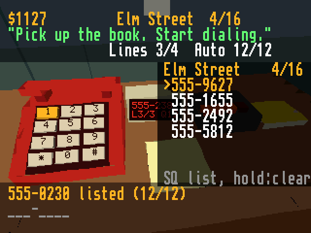
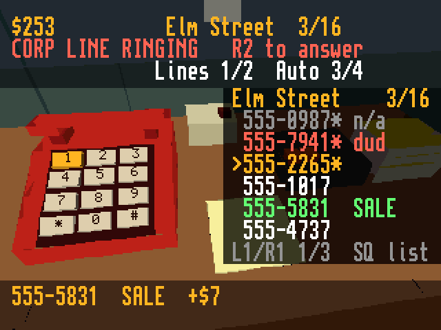

# Phone books

The second game on the disc, picked on the boot screen. You are stuck at a desk making cold calls
for a corporation that never says what it sells, and you do not remember applying. The corporation
pays a little for every call that rings and a bonus when somebody listens to the whole pitch. Work
through the residential phone books one by one. Somebody higher up is watching your numbers.

This is phase 1 of the concept: the residential books, the lines, a bad autodialer, the corp on
the phone, and the first note. Promotions to the other categories come later; the office screen
shows them locked.

## Controls

| Button | Does |
| --- | --- |
| D-pad | move over the keypad |
| X | dial the key under the cursor |
| O | take back the last digit you dialed |
| L2 | hang up your call |
| R2 | answer the corp line when it rings |
| Triangle | open and close the phone book |
| L1 / R1 | move up / down the book (book open) |
| Square | put the number under the cursor on the autodialer's list, or take it off |
| Square, held 1 s | empty the autodialer's list (book open) |
| Select | supplies (the shop) |
| START | the office: your stats, the books, the categories; X there shows the how-to-play card |

## The screen

Four rows, always: your cash with the open book and how many of its numbers you have called, the
corp line in quotes, your quota and how many of your lines are busy (plus the autodialer's list
once you own one), and at the bottom the number on your handset. The book, the shop and the office
are panels you open when you want them.

## Calling

Open the book (Triangle), read a number, close it or leave it open, and dial it on the keypad.
Every number is 555 and four digits. After the seventh digit the call connects and one of these
happens:

| Outcome | How often | Pays | The book marks it |
| --- | --- | --- | --- |
| not in service | the book's dud chance, fixed per number | nothing | `dud` |
| they pick up and listen | the book's pick-up chance | fee + bonus | `SALE` |
| no answer (rings 5.5 s) | half of the rest | fee | `n/a` |
| hello, not interested, click | the other half | fee | `hung` |

A dud answers with the fast busy tone, which stops after a second and a half or as soon as you
dial the next digit. A dud stays a dud: calling it again is wasted time. Somebody who already listened once hangs up on
you every time after, so a `SALE` number only pays the fee again. A number that is in no open book
is not in service. You can hang up (L2) at any time, but a call you hang up on pays nothing.

## The books

Every number in a book has to be called once (any outcome) to finish it. Finishing a book puts it
on the done pile behind the stack on the desk and opens the next one.

| Book | Numbers | Duds | Pick-up | Fee | Bonus |
| --- | --- | --- | --- | --- | --- |
| Elm Street | 16 | 30% | 40% | $1 | $6 |
| Oak Avenue | 24 | 25% | 34% | $1 | $9 |
| Maple Heights | 32 | 20% | 28% | $2 | $14 |
| Pine Ridge | 40 | 15% | 24% | $2 | $20 |

The numbers are generated from a seed picked on a new game and kept in the save, so the books stay
the same between sessions. Small business, large business and CEOs are listed in the office as
locked: you get there by promotion, which is not in phase 1.

## Lines

You start with one line. Supplies sells more, up to ten, at $30 for the second and twice the price
for each one after ($60, $120, $240, ... $7680 for the tenth). A line board on the desk has a lamp
per line you own, lit while it is on a call. Your handset takes the first free line; with every
line busy the keypad gets "every line is busy".

## The autodialer starts out bad, on purpose

$25 in supplies. It knows nothing of the phone book: you give it a list. With the book open,
Square puts the number under the cursor on its list (a `*` beside it), or takes it off. It works
down the list one call at a time on a free line that is not your handset's, then starts the list
again, forever, with no judgement at all: duds, numbers that already said no, numbers you already
sold to.

| | Starts at | Motor 1 ($60) | Motor 2 ($150) |
| --- | --- | --- | --- |
| time per digit | 40 frames | 22 | 10 |
| rest between calls | 3 s | 1.7 s | 0.8 s |

The list only ever holds numbers from the open book. You cannot pick a book yourself: the open
book is the first one not finished, so the book changes only when you finish it, and at that moment
its numbers drop off the list and the autodialer waits for numbers from the new one. The last book
stays open once it is finished, so its list stays. A save made before this rule that still has an
old book's numbers listed is cleaned up when it loads. Holding Square for a second with the book open
empties the whole list; the book's bottom line takes turns between the keys and that reminder.

The list holds 4 numbers, 8 with the first bigger tray ($80), 12 with the second ($200). It pays
the same fee and bonus as a call you make yourself.

## The corp calls you

About a minute in, and then every 3 to 4 minutes, the corp line rings (the lamps flash, the
second row turns red). R2 answers it. Its clock stops while somebody is listening on your own line,
so it never cuts into a pitch. The first call sets a quota of 8 calls per line you own before the
next one. Each quota you meet raises it by 2 calls per line (up to 14 per line), each one you miss
lowers it by 2 again. A call by hand takes about 8 to 10 seconds, dialing included, so 8 calls fit
easily before the corp calls back. When it calls again:

- quota met: you get half the quota in dollars;
- quota missed: you lose a dollar per missing call, never below zero;
- you do not answer within 8 seconds: you lose $3 and it calls back a minute later, the quota
  still standing.

Between calls the corp line says something motivational every 25 seconds or so.

## The office

START: calls made, sales, duds, money earned, play time, every residential book with its progress,
the three locked categories, and the memory card. X there shows the how-to-play card again.

## The note

When every number in the last residential book has been called, a sticky note turns up in the book.
It reads like one more entry, in yellow at the end of Pine Ridge, and the banner says who left it:
somebody who saw your numbers and wants out too. Dial it by hand (the autodialer cannot read
handwriting). That is the end of phase 1: a short call, then "to be continued", then back to the
desk, where everything still works.

## Saving

Phone books has its own save file on the memory card in slot 1 (DIALBOOK), separate from the radio
game's (DIALTONE), so the two never overwrite each other. The pad does not answer while the card is
being written (about four seconds), so it only saves at a natural pause: when a book is finished,
when the corp call ends (answered or missed), when the note turns up and when its call is over, and
when you open the office with START (if the last save is at least 30 seconds old; the game is paused
there). Outside the office a save also waits until your line is free and the shop and the book are
shut. While it writes, the bottom of the screen says `SAVING to memory card - hands off` in red
(in the office, the card line says so instead).

## Numbers in one place

Everything above is in `src/book_sim.cpp`: the book table at the top, the timings under it, the
prices in `ShopPrice`, the corp in `TickSupervisor` and `AnswerSupervisor`.
